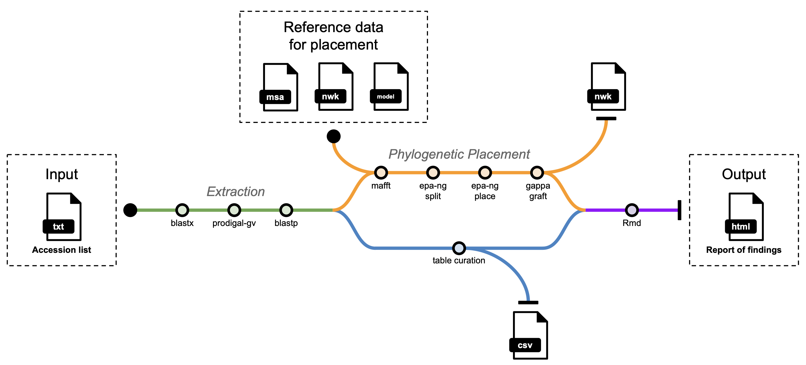

# NCV_PolB_Meta_Fragments

## Introduction
NCV-PolB_Meta_Fragments is a nextflow pipeline that identifies, extracts, and analyses potential fragments of the giant virus DNA polymerase B gene from metagenomic data.

Project Status: Work in Progress (WIP)

